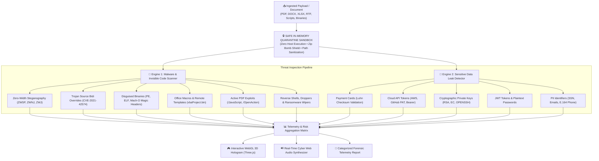

<div align="center">

# 🛡️ SENTINEL CORE
### Dual-Engine Data Leak Prevention & Invisible Malware Detection Matrix

[](https://python.org)
[](https://fastapi.tiangolo.com)
[](https://threejs.org)
[](https://docker.com)
[](https://mongodb.com)
[](https://opensource.org/licenses/MIT)

<p align="center">
  <b>A real-time cybersecurity engine combining deep multi-format document data leak auditing with safe in-memory malware inspection, zero-width steganography neutralization, and an interactive ray-traced 3D holographic defense matrix.</b>
</p>

[Explore Capabilities](#-core-capabilities) •
[Host Safety Guarantee](#-zero-execution-host-safety-guarantee) •
[Quick Start](#-quick-start) •
[Docker Deployment](#-production-deployment) •
[API Specs](#-rest-api-reference)

---

</div>

## 🌐 Architectural Defense Matrix



---

## 🌟 Core Capabilities

### 1. 👁️ Malicious Invisible Code & Steganography Defense
* **Zero-Width Unicode Steganography**: Uncovers concealed payloads hidden with Zero-Width Space (`\u200B`), Non-Joiner (`\u200C`), Joiner (`\u200D`), Word Joiner (`\u2060`), invisible operators (`\u2061`–`\u2064`), and embedded Byte Order Marks (`\uFEFF`).
* **Steganographic Binary Extraction**: Automatically reconstructs binary bitstreams hidden inside zero-width character sequences into decoded ASCII text.
* **Trojan Source Attacks (CVE-2021-42574)**: Identifies Bidirectional (Bidi) text overrides (`\u202A`–`\u202E`, `\u2066`–`\u2069`) that visually invert displayed code logic to deceive human reviewers while executing malicious paths in compilers and runtimes.
* **Whitespace Steganography**: Detects anomalous trailing whitespace sequences (SNOW steganography covert channels).
* **Homoglyph & Confusable Identifiers**: Flags mixed-script Cyrillic/Greek lookalikes designed to spoof trusted function identifiers or domain names.

### 2. ☣️ Malware, Exploit & Dropper Inspection
* **Disguised Executable Masquerading**: Inspects magic bytes (`MZ` Windows PE, `\x7fELF` Linux, Mach-O macOS) disguised under benign extensions (`.pdf`, `.docx`, `.jpg`, `.txt`), plus double extension social engineering attacks (`invoice.pdf.exe`).
* **Embedded Office Macros & Template Injections**: Scans OpenXML containers (`.docx`, `.xlsx`, `.xlsm`, `.docm`) for embedded `vbaProject.bin`, auto-exec triggers (`AutoOpen`, `Workbook_Open`), dangerous system APIs (`Shell`, `WScript.Shell`, `WinExec`, `PowerShell`), and remote template injection (Follina / CVE-2022-30190).
* **Active PDF Exploits**: Detects `/JavaScript`, `/OpenAction` auto-executors, `/Launch` binary primitives, and hidden `/EmbeddedFiles`.
* **RTF Embedded OLE Objects**: Flags OLE compound objects (CVE-2017-11882 Microsoft Equation Editor memory corruption vector).
* **Interactive Reverse Shells**: Detects Bash `/dev/tcp/`, Netcat, Socat, Python, PHP, and Ruby remote shell payloads.
* **Destructive Commands & Ransomware Wipers**: Identifies volume shadow copy deletion (`vssadmin`, `wmic`), filesystem wipers (`rm -rf /`, `format C:`), and fork bombs (`:(){ :|:& };:`).
* **Concealed Base64 Droppers**: Automatically inspects base64 blobs for concealed executables, EICAR signatures, or encoded PowerShell memory droppers.
* **EICAR Anti-Virus Standard Verification**: Full built-in support for industry-standard EICAR anti-virus scanner verification.

### 3. 🔑 Sensitive Data Leak Detection Matrices
| Classification | Detection Mechanism | Compliance & Severity |
| :--- | :--- | :--- |
| **Payment Cards** | Visa, Mastercard, Amex, Discover + **Luhn Algorithm Checksum** | 🔴 `CRITICAL` (PCI-DSS) |
| **Private Keys** | Cryptographic Key Blocks (`RSA`, `EC`, `OPENSSH`, `DSA`, `PGP`) | 🔴 `CRITICAL` (FIPS 140) |
| **Cloud API Secrets** | AWS Access Keys (`AKIA...`), GitHub Personal Access Tokens (`ghp_`), Bearer tokens | 🔴 `CRITICAL` (SOC 2) |
| **Session Credentials** | JSON Web Tokens (`eyJ...`), Plaintext Passwords (`passwd = ...`) | 🔴 `CRITICAL` (OWASP A07) |
| **Social Security** | US Social Security Numbers (`XXX-XX-XXXX`) | 🟠 `HIGH` (PII / HIPAA) |
| **Personal Identifiers** | Personal Email Addresses, Direct Phone Numbers (E.164 compliant) | 🟡 `MEDIUM` (GDPR / CCPA) |
| **Network Infrastructure** | Public & Private IPv4 Network Addresses | 🔵 `LOW` (Network Recon) |

---

## 🔒 Zero-Execution Host Safety Guarantee

When auditing malicious or weaponized files, SENTINEL CORE guarantees that **the host system remains 100% isolated and safe**:

```
┌────────────────────────────────────────────────────────────────────────┐
│                   🛡️ HOST SECURITY ISOLATION LAYER                     │
├────────────────────────────────┬───────────────────────────────────────┤
│ 1. Zero-Execution Policy       │ No eval(), exec(), os.system(), or    │
│                                │ subprocess calls are ever invoked.   │
├────────────────────────────────┼───────────────────────────────────────┤
│ 2. In-Memory Quarantine        │ Files are processed strictly in RAM   │
│                                │ as inert bytes (io.BytesIO).          │
├────────────────────────────────┼───────────────────────────────────────┤
│ 3. Decompression Bomb Shield   │ Max 60 MB uncompressed limit, max     │
│                                │ 100:1 compression ratio, max 500 files│
├────────────────────────────────┼───────────────────────────────────────┤
│ 4. Path Traversal Neutralizer  │ Strips null bytes (\0), ../, ..\, and │
│                                │ shell metacharacters from filenames.  │
├────────────────────────────────┼───────────────────────────────────────┤
│ 5. Isolated Parser Sandboxes   │ Guarded exception barriers prevent     │
│                                │ malformed parser zero-day crashes.    │
└────────────────────────────────┴───────────────────────────────────────┘
```

---

## 🎮 Interactive Hologram & Cyber Web Audio

* **Three.js WebGL 3D Defense Matrix**:
  * Real-time ray-traced wireframe shield with orbiting 1,500-particle constellation.
  * Dynamically transitions from **Fortified Cyan/Emerald** to pulsating **Crimson Red** upon detecting active malware or critical leaks.
  * Drag-to-rotate touch controls on mobile and orbital mouse controls on desktop.
* **Synthesized Procedural Web Audio (Web Audio API)**:
  * Zero external audio files or network requests — procedural sound waves synthesized in real-time.
  * **⚡ UI Click Chirps**: Responsive metallic haptic chirp on clicking buttons and tabs.
  * **📡 Radar Sweep**: Ascending laser wave when auditing starts.
  * **🛡️ Harmonic Chime**: Ascending quad-tone chime (`C5`–`C6`) when a document is clean.
  * **☣️ Threat Klaxon Siren**: Double-pulse warning siren upon threat detection.
  * **🔊 Audio Control**: One-click mute/unmute toggle in the navbar.

---

## 🚀 Quick Start

### 1. Local Python Setup
```bash
# Clone the repository
git clone https://github.com/Kishan-shah12/Personal-Data-Leak-Detector.git
cd Personal-Data-Leak-Detector

# Create and activate virtual environment
python3 -m venv venv
source venv/bin/activate  # On Windows: venv\Scripts\activate

# Install dependencies
pip install -r requirements.txt

# Start local server
uvicorn app.main:app --host 127.0.0.1 --port 8000 --reload
```
Open **[http://127.0.0.1:8000](http://127.0.0.1:8000)** in your browser.

---

## 🐳 Production Deployment

### Option A: Docker (Recommended)

Run as an isolated, unprivileged non-root container:

```bash
# Build the production image
docker build -t sentinel-core:latest .

# Run container on port 8000
docker run -d \
  --name sentinel_app \
  -p 8000:8000 \
  --restart unless-stopped \
  sentinel-core:latest
```

### Option B: Docker Compose (Full Stack with MongoDB)

Deploy SENTINEL CORE along with a persistent MongoDB 7.0 telemetry store:

```bash
docker compose up -d
```

View logs:
```bash
docker compose logs -f
```

---

## ☁️ 1-Click Cloud Deployment

| Cloud Platform | Deployment Method | Notes |
| :--- | :--- | :--- |
| **Vercel** | Push to GitHub or run `vercel` | Serverless ASGI function via `vercel.json` |
| **Render** | Push repository; uses `render.yaml` Blueprint | Auto-detects `PORT`, zero config |
| **Railway** | Deploy from GitHub repo | Automatic Dockerfile detection |
| **Fly.io** | `fly launch` | MicroVM deployment with non-root user |
| **Heroku** | Deploy with `Procfile` | Uses dynamic `$PORT` binding |
| **AWS ECS / GCP Run** | Push container to ECR / Artifact Registry | Serverless container execution |

### Deploying to Vercel (Serverless)

SENTINEL CORE includes pre-configured serverless handlers for Vercel:

1. **Via Vercel CLI**:
   ```bash
   npm i -g vercel
   vercel
   ```
2. **Via Vercel Web Dashboard**:
   - Import your GitHub repository into Vercel.
   - Vercel automatically detects [`vercel.json`](file:///Users/kishansah/PR(Data%20leak%20Detector)/vercel.json) and [`api/index.py`](file:///Users/kishansah/PR(Data%20leak%20Detector)/api/index.py).
   - Click **Deploy** — your live application URL will be generated immediately.

---

## 📡 REST API Reference

Interactive Swagger documentation is available at **`/docs`** (OpenAPI at **`/openapi.json`**).

### 1. Ingest & Audit Payload
`POST /api/scan`

**Parameters (multipart/form-data):**
* `file` *(UploadFile, optional)*: Document or binary to quarantine and scan.
* `text` *(string, optional)*: Raw log stream, code, or payload text.

**Example Response:**
```json
{
  "status": "success",
  "source": "file:invoice_2026.docx",
  "document_type": "Word Document (.docx)",
  "extracted_chars": 4820,
  "risk_level": "CRITICAL",
  "malware_status": "MALICIOUS",
  "malware_threat_count": 2,
  "leak_count": 1,
  "entropy": 6.84,
  "malware_findings": [
    {
      "category": "Invisible Code: Trojan Source Inversion (CVE-2021-42574)",
      "severity": "Critical",
      "detected_value": "2 Bidirectional Override Character(s)",
      "location": "Text Stream / Code Flow",
      "snippet": "Detected Bidi overrides: Right-to-Left Override (RLO) (x1)...",
      "recommendation": "Reject file or strip all Unicode bidirectional overrides immediately."
    }
  ],
  "leak_findings": [
    {
      "category": "Credit Card",
      "severity": "Critical",
      "detected_value": "4532-****-****-5671",
      "location": "[Page 1] (Line 14)",
      "recommendation": "High financial fraud risk under PCI-DSS. Tokenize or redact."
    }
  ],
  "safety_sandbox": {
    "in_memory_sandbox": true,
    "zero_execution_guarantee": true,
    "host_isolation": "ACTIVE"
  }
}
```

### 2. Neutralize & Cleanse Invisible Threats
`POST /api/sanitize`

Strips all zero-width characters and Trojan Source overrides, returning clean text.

```json
{
  "status": "success",
  "removed_characters_count": 14,
  "sanitized_text": "// Cleaned code stream...",
  "message": "Successfully stripped 14 invisible character(s) / Trojan Source overrides."
}
```

### 3. Engine Health Check
`GET /api/health`

```json
{
  "status": "online",
  "engine": "SENTINEL CORE v2.0 (Dual Leak & Malware Defense)",
  "mongodb_connected": true,
  "safety_guarantee": {
    "in_memory_quarantine": "ENABLED",
    "zero_execution_policy": "ACTIVE"
  }
}
```

---

## 🧪 Automated Testing

SENTINEL CORE includes an automated test suite verifying all detection matrices and quarantine boundaries:

```bash
# Run unit and integration suite
python3 -m unittest discover tests
```

**Coverage includes:**
* Path traversal and null byte neutralization tests.
* Zero-width character steganography and automated binary extraction.
* Trojan Source (CVE-2021-42574) Bidi override detection.
* PE, ELF, and Mach-O header masquerade detection.
* Office OpenXML VBA macro inspection and auto-run hooks.
* PDF active `/JavaScript` and `/OpenAction` trigger detection.
* Zip bomb compression ratio and size limit enforcement.
* Shannon entropy computation.
* End-to-end API scan integration tests.

---

## 📁 Repository Structure

```
├── api/
│   └── index.py            # Vercel serverless function entrypoint
├── app/
│   ├── database.py         # MongoDB persistent telemetry & connection caching
│   ├── detector.py         # Sensitive data leak regex matrices & Luhn validator
│   ├── extractor.py        # Multi-format document text extractor (PDF, DOCX, XLSX, RTF)
│   ├── malware_scanner.py  # Safe in-memory malware & invisible code inspection engine
│   └── main.py             # FastAPI production application, CORS & API routes
├── templates/
│   └── index.html          # Futuristic Three.js UI, dual telemetry workbench & Web Audio
├── tests/
│   └── test_scanner.py     # Automated unit and integration test suite
├── vercel.json             # Vercel serverless build & route configuration
├── .vercelignore           # Vercel build bundle exclusions
├── Dockerfile              # Multi-stage secure non-root Docker build
├── docker-compose.yml      # Full-stack Docker Compose (SENTINEL + MongoDB 7.0)
├── .dockerignore           # Production Docker build exclusions
├── Procfile                # Heroku / Railway / Render deployment entrypoint
├── render.yaml             # Render cloud Blueprint specification
├── .env.example            # Environment configuration template
├── requirements.txt        # Production Python dependencies
└── README.md               # Architecture documentation & quickstart guide
```

---

## 👨‍💻 Author & Creator

* **Creator & Architect**: **Kishan Sah**
* **LinkedIn**: [](https://www.linkedin.com/in/kishan-sah-b97a73315/)
* **Direct Profile**: [https://www.linkedin.com/in/kishan-sah-b97a73315/](https://www.linkedin.com/in/kishan-sah-b97a73315/)

---

## 📜 Security Policy & License

* **Security Policy**: All files submitted to SENTINEL CORE are processed in volatile memory. Files are never stored permanently unless MongoDB sync is explicitly configured by the administrator.
* **License**: Distributed under the **MIT License**. See `LICENSE` for details.

<div align="center">
  <sub>Developed with 🛡️ by <strong>Kishan Sah</strong> for modern security teams and privacy-conscious developers.</sub>
</div>
